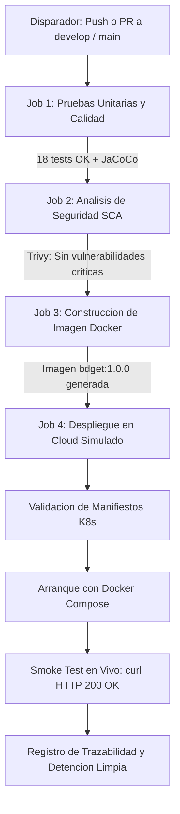

# bdget 🎓 — Microservicio de Gestión de Estudiantes

> **Evaluación Parcial N°1 & N°2: "Añadiéndole complejidad a nuestro pipeline"**  
> **Asignatura:** Ingeniería DevOps (DOY0101) — Duoc UC  
> **Ponderación Evaluación 1:** 25% | **Ponderación Evaluación 2:** 45%  

---

## 👥 Información del Equipo

* **Institución:** Duoc UC
* **Carrera:** Ingeniería en Informática / Conectividad y Redes
* **Integrantes:**
  * **Valentina Ruiz** — `va.ruizi@duocuc.cl`
  * **Michelle Gauna** — `ma.gauna@duocuc.cl` (`Miichellee1`)
* **Repositorio GitHub:** [https://github.com/Miichellee1/DevOps-Wisdom-](https://github.com/Miichellee1/DevOps-Wisdom-)

---

## 📖 Descripción General del Proyecto

`bdget` es un microservicio REST desarrollado en **Java 17 + Spring Boot 3** para la gestión integral de estudiantes (CRUD, búsqueda por nombre y métricas estadísticas). El proyecto incorpora un ciclo de vida de desarrollo DevOps y DevSecOps completamente automatizado mediante **GitHub Actions**, incluyendo:

1. **Suite de Pruebas Automatizadas:** 18 tests unitarios con JUnit 5 y Mockito, con análisis de cobertura de código vía **JaCoCo**.
2. **Seguridad y Análisis de Vulnerabilidades (DevSecOps):** Escaneo continuo de dependencias con **Dependabot**, escaneo de seguridad estático y de contenedores con **Trivy / Snyk**, y políticas de bloqueo (*Security Gates*).
3. **Contenerización y Hardening:** `Dockerfile` multi-etapa optimizado con imagen liviana Eclipse Temurin 17 JRE y ejecución con usuario sin privilegios de root.
4. **Orquestación y Escalabilidad:** Arquitectura orquestada mediante **Docker Compose** y manifiestos de **Kubernetes** (`k8s/`) con definición de límites de recursos, sondas de salud (*liveness/readiness probes*) y escalamiento horizontal (*HPA*).
5. **Despliegue Automatizado y Smoke Testing:** Despliegue en un entorno cloud simulado (runners de GitHub Actions) con validación automática en vivo (*Health Checks*).

---

## 🚀 Cómo Levantar el Proyecto Localmente

### Opción 1: Ejecución con Maven Wrapper (Nativo)
```bash
# Ejecutar la aplicacion
./mvnw spring-boot:run          # Linux / macOS
.\mvnw.cmd spring-boot:run      # Windows

# Ejecutar las 18 pruebas unitarias y generar reporte JaCoCo
./mvnw clean test               # Linux / macOS
.\mvnw.cmd clean test           # Windows
```
* **API REST:** `http://localhost:8080/students`
* **Consola H2 (en memoria):** `http://localhost:8080/h2-console` (JDBC URL: `jdbc:h2:mem:bdgetdb`, usuario: `sa`, sin contraseña).

### Opción 2: Ejecución Orquestada con Docker Compose
```bash
# Construir la imagen y levantar el servicio en segundo plano
docker compose up -d --build

# Verificar el estado y salud del contenedor
docker compose ps

# Ver logs en tiempo real
docker compose logs -f

# Detener los servicios
docker compose down
```

---

## 📁 Estructura del Proyecto

```
DevOps-Wisdom-/
├── .github/
│   ├── workflows/
│   │   └── main.yml           → Pipeline CI/CD DevSecOps automatizado en GitHub Actions
│   └── dependabot.yml         → Configuracion de escaneo de dependencias automatizado
├── k8s/                       → Manifiestos de orquestacion para Kubernetes
│   ├── deployment.yaml        → Despliegue con 2 replicas, recursos y health probes
│   ├── service.yaml           → Exposicion del servicio mediante NodePort 30080
│   └── hpa.yaml               → Autoscalado horizontal de pods basado en CPU (2 a 5 replicas)
├── src/
│   ├── main/java/...          → Codigo fuente REST (Controller, Service, Repository, Model)
│   └── test/java/...          → 18 pruebas unitarias (MockMvc, Mockito, SpringBootTest)
├── docker-compose.yml         → Orquestacion local con limites de recursos y red bridge
├── Dockerfile                 → Contenedorizacion multi-etapa segura (Non-root, Temurin 17)
├── pom.xml                    → Dependencias Maven y configuracion de plugin JaCoCo
├── mvnw / mvnw.cmd            → Maven Wrapper ejecutable multiplataforma
└── README.md                  → Documentacion tecnica integral
```

---

## 🐳 Contenerización y Hardening de Seguridad (Indicador IE1)

El archivo [Dockerfile](Dockerfile) implementa las mejores prácticas de la industria en ingeniería de contenedores para la nube:

1. **Construcción Multi-Etapa (*Multi-Stage Build*):**
   * **Etapa 1 (`buildstage`):** Utiliza `eclipse-temurin:17-jdk` para compilar y empaquetar el binario JAR, descartando las herramientas de compilación pesadas al finalizar.
   * **Etapa 2 (`producción`):** Utiliza `eclipse-temurin:17-jre`, reduciendo drásticamente la superficie de ataque y el peso final de la imagen.
2. **Principio de Mínimo Privilegio (Non-Root User):**
   * Se crea un usuario y grupo de sistema sin privilegios (`appuser:appgroup`), evitando que el contenedor se ejecute con privilegios de `root` en el host o en el clúster.
3. **Parámetros JVM para Entornos Cloud:**
   * `JAVA_OPTS="-XX:+UseContainerSupport -XX:MaxRAMPercentage=75.0"`: Asegura que la máquina virtual de Java reconozca los límites de memoria física impuestos por Docker o Kubernetes y no exceda las cuotas del sistema (prevención de errores *OOMKilled*).
4. **Sonda Nativa de Salud (`HEALTHCHECK`):**
   * Monitoreo nativo del contenedor cada 30 segundos validando respuesta HTTP en `/students`.

---

## 🛡️ Seguridad, Dependabot y Security Gates (Indicador IE3)

La seguridad se integró como un elemento fundamental en todo el ciclo de entrega de software (*Shift-Left Security*):

### 1. Escaneo Automatizado de Dependencias con Dependabot
El archivo [.github/dependabot.yml](.github/dependabot.yml) supervisa y actualiza de manera continua:
* **Ecosistema Maven (`pom.xml`):** Escaneo semanal de dependencias de Spring Boot y librerías externas.
* **Ecosistema GitHub Actions:** Actualización de versiones de acciones en los workflows.
* **Ecosistema Docker:** Supervisión de parches de seguridad sobre la imagen base de Temurin.

### 2. Escaneo de Vulnerabilidades y Bloqueo en Pipeline (Security Gate)
En el pipeline de GitHub Actions se ejecuta el analizador de seguridad **Trivy (SCA & Container Security)**:
* **Escaneo de Código y Librerías:** Analiza las dependencias Maven en busca de CVEs conocidos.
* **Escaneo de la Imagen Docker:** Inspecciona los paquetes del sistema operativo base del contenedor.
* **Política de Bloqueo (*Fail-on-Severity*):** Si se detecta alguna vulnerabilidad clasificada como **`CRITICAL`**, el job falla automáticamente (`exit-code: 1`), **bloqueando el pipeline e impidiendo el empaquetado o despliegue a producción**.

---

## ☸️ Orquestación de Contenedores y Escalabilidad (Indicador IE5)

Se proporcionan dos soluciones de orquestación diseñadas para alta disponibilidad y resiliencia:

### 1. Orquestación con Docker Compose (`docker-compose.yml`)
* **Límites de Recursos:**
  * Límite estricto (*Limits*): Máximo `0.50` CPU y `512MB` de memoria RAM.
  * Reserva mínima (*Reservations*): `0.25` CPU y `256MB` de memoria RAM.
* **Aislamiento de Red:** Red dedicada tipo *bridge* (`bdget-network`) para aislar el microservicio.
* **Política de Resiliencia:** `restart_policy: condition: on-failure` con hasta 3 reintentos automáticos.

### 2. Orquestación Empresarial con Kubernetes (`k8s/`)
* **`k8s/deployment.yaml`:**
  * **2 Réplicas** activas para garantizar tolerancia a fallos.
  * Estrategia **RollingUpdate** (`maxSurge: 1`, `maxUnavailable: 0`) para actualizaciones con cero tiempo de inactividad (*Zero Downtime Deployment*).
  * **Sondas de Salud:** `readinessProbe` (verifica si el pod está listo para recibir tráfico) y `livenessProbe` (reinicia el pod si la aplicación deja de responder).
  * **Contexto de Seguridad:** `runAsNonRoot: true` para cumplimiento de gobernanza y políticas de clúster.
* **`k8s/service.yaml`:** Exposición desacoplada mediante servicio `NodePort` en el puerto `30080`.
* **`k8s/hpa.yaml`:** Autoscalado Horizontal (*HPA*) que escala dinámicamente entre **2 y 5 réplicas** si el consumo promedio de CPU supera el 70%.

---

## ⚙️ Pipeline CI/CD DevSecOps y Entorno Cloud Simulado (Indicador IE2, IE3 e IE4)

El pipeline implementado en [.github/workflows/main.yml](.github/workflows/main.yml) automatiza el ciclo de vida completo en 4 fases interdependientes:



### Detalle de las Etapas del Pipeline:
1. **Job 1 (`unit-tests` - IE2):** Ejecuta la suite de 18 pruebas unitarias con JUnit 5 y genera el reporte de cobertura de código JaCoCo como artefacto.
2. **Job 2 (`security-scan` - IE3):** Escanea dependencias con Trivy y aplica la política de bloqueo si existen vulnerabilidades críticas.
3. **Job 3 (`build-container` - IE1):** Construye la imagen Docker multi-etapa y analiza su seguridad.
4. **Job 4 (`deploy-simulation` - IE4 & IE5):**
   * Valida la sintaxis de los manifiestos de Kubernetes con `kubectl apply --dry-run=client`.
   * Despliega la orquestación en el runner con `docker compose up -d`.
   * Ejecuta un **Smoke Test automatizado** con `curl` validando en bucle que `/students` y `/students/count` respondan código `200 OK`.
   * Captura y preserva los logs de ejecución para trazabilidad completa.

---

## 🌳 Estrategia de Ramificación y Buenas Prácticas (Evaluación 1 & 2)

* **Modelo de Ramificación:** **GitFlow** formal (`main`, `develop`, `feature/*`, `hotfix/*`).
* **Convención de Commits:** **Conventional Commits v1.0.0** (`feat:`, `fix:`, `chore:`, `docs:`, `test:`).
* **Estrategia de Merge:** Preservación de la historia de ramas mediante `--no-ff`.

---

## ⚖️ Declaración de Uso Ético de Inteligencia Artificial (Normativa Duoc UC)

En cumplimiento de las instrucciones de la asignatura y la política institucional sobre uso de Inteligencia Artificial:

1. **Herramientas de IA Utilizadas:** Se utilizó un asistente de IA generativa como apoyo técnico.
2. **Aplicación Específica en la Evaluación:**
   * Asistencia en el diseño de sintaxis y diagramas Mermaid del pipeline en el `README.md`.
   * Verificación de sintaxis de los manifiestos de Kubernetes (`deployment.yaml`, `service.yaml`, `hpa.yaml`).
   * Consulta sobre mejores prácticas de hardening en Dockerfile y opciones de escaneo con Trivy.
3. **Declaración de Autoría y Responsabilidad:**
   * Todas las decisiones arquitectónicas, configuración de límites de recursos, diseño de pruebas unitarias y validación del pipeline fueron ejecutadas, probadas y supervisadas por el equipo de estudiantes.
   * El equipo asume total responsabilidad de la originalidad del proyecto.
4. **Referencia Institucional:** [https://bibliotecas.duoc.cl/ia](https://bibliotecas.duoc.cl/ia).

---

## 💡 Reflexiones Individuales Obligatorias (Normativa Duoc UC)

*(Cada integrante redacta a continuación su reflexión personal, de forma individual y sin apoyo de IA, explicando su aprendizaje y contribución al proyecto).*

### 👤 Reflexión de Valentina Ruiz
> *(Espacio para que Valentina redacte su reflexión personal sobre el aprendizaje en DevSecOps, la orquestación con Docker Compose/Kubernetes y el despliegue continuo).*

### 👤 Reflexión de Michelle Gauna
> *(Espacio para que Michelle redacte su reflexión personal sobre la seguridad en pipelines, el ajuste de límites de recursos y la contenerización segura).*
