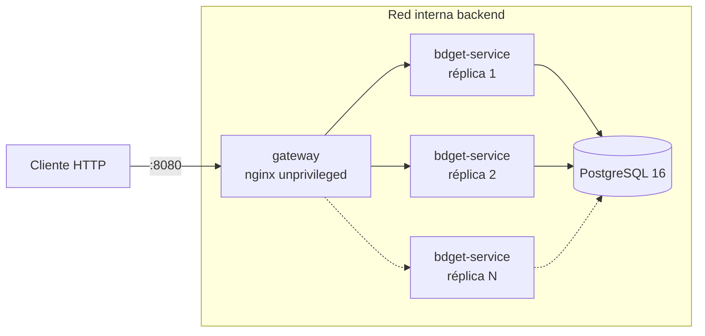
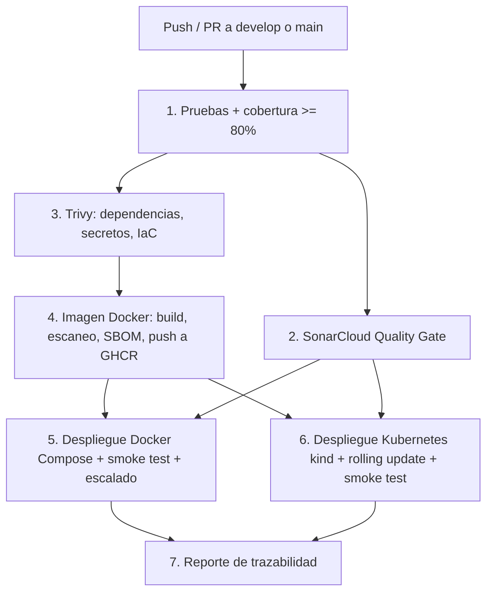

# bdget 🎓 — Microservicio de Gestión de Estudiantes

[](https://github.com/Miichellee1/DevOps-Wisdom-/actions/workflows/main.yml)
[](https://sonarcloud.io/summary/new_code?id=Miichellee1_DevOps-Wisdom)
[](https://sonarcloud.io/summary/new_code?id=Miichellee1_DevOps-Wisdom)

> **Evaluación Parcial N°2: "Añadiéndole complejidad a nuestro pipeline"**
> **Asignatura:** Ingeniería DevOps (DOY0101) — Duoc UC
> **Ponderación Evaluación 1:** 25% | **Ponderación Evaluación 2:** 45%

---

## 👥 Información del Equipo

* **Institución:** Duoc UC
* **Carrera:** Ingeniería en Informática / Conectividad y Redes
* **Integrantes:**
  * **Valentina Ruiz** — `va.ruizi@duocuc.cl`
  * **Michelle Serrano** — `mich.serrano@duocuc.cl` (`Miichellee1`)
* **Repositorio GitHub:** [https://github.com/Miichellee1/DevOps-Wisdom-](https://github.com/Miichellee1/DevOps-Wisdom-)

---

## 📖 Descripción General del Proyecto

`bdget` es un microservicio REST desarrollado en **Java 17 + Spring Boot 3.5** para la gestión de estudiantes (CRUD, búsqueda por nombre y conteo). Su ciclo de vida completo está automatizado con un pipeline **CI/CD DevSecOps en GitHub Actions** que:

1. Ejecuta **26 pruebas automatizadas** (unitarias, de controlador y de integración con base de datos) y **bloquea** si la cobertura baja del 80%.
2. Analiza la calidad y seguridad del código con **SonarCloud** y **bloquea** si el *Quality Gate* falla.
3. Escanea dependencias, secretos e infraestructura como código con **Trivy** y **bloquea** ante vulnerabilidades `CRITICAL`/`HIGH` con parche disponible. **Dependabot** mantiene las dependencias actualizadas.
4. Construye una **imagen Docker multi-etapa endurecida**, la escanea, genera su **SBOM** y la publica en **GitHub Container Registry** etiquetada con el SHA del commit.
5. **Despliega automáticamente** esa misma imagen en dos entornos simulados: **Docker Compose** (gateway nginx + réplicas + PostgreSQL) y un clúster **Kubernetes (kind)**, validando cada despliegue con un *smoke test* funcional.

---

## 🏗️ Arquitectura



| Componente | Imagen | Rol |
|---|---|---|
| `gateway` | `nginxinc/nginx-unprivileged:1.27-alpine` | Reverse proxy y balanceo de carga entre réplicas, sin root |
| `bdget-service` | `ghcr.io/miichellee1/devops-wisdom:sha-<commit>` | Microservicio Spring Boot (escalable horizontalmente) |
| `db` | `postgres:16-alpine` | Persistencia; solo accesible desde la red interna |

Perfiles de Spring Boot:
* **default:** H2 en memoria (desarrollo y pruebas, sin infraestructura externa).
* **dev:** igual que default, con la consola H2 habilitada.
* **prod:** PostgreSQL con credenciales inyectadas por variables de entorno (Docker Compose y Kubernetes).

---

## 🚀 Cómo Levantar el Proyecto Localmente

### Opción 1: Maven Wrapper (H2 en memoria)
```bash
./mvnw spring-boot:run                                   # Linux / macOS
.\mvnw.cmd spring-boot:run                               # Windows
./mvnw spring-boot:run -Dspring-boot.run.profiles=dev    # con consola H2 en /h2-console

./mvnw verify    # pruebas + reporte JaCoCo + validación de cobertura mínima
```

### Opción 2: Entorno completo con Docker Compose
```bash
cp .env.example .env               # opcional: personalizar clave, réplicas o imagen
docker compose up -d --build --wait
bash scripts/smoke-test.sh          # verificación funcional de la API
docker compose up -d --scale bdget-service=3 --wait   # escalar horizontalmente
docker compose down -v
```

Endpoints principales (a través del gateway en `http://localhost:8080`):

| Método | Ruta | Descripción |
|---|---|---|
| GET | `/students` | Lista estudiantes |
| GET | `/students/{id}` | Obtiene un estudiante (404 si no existe) |
| GET | `/students/search?name=` | Busca por nombre |
| GET | `/students/count` | Cuenta estudiantes |
| POST | `/students` | Crea (400 si el nombre no es válido) |
| PUT | `/students/{id}` | Actualiza (404 si no existe) |
| DELETE | `/students/{id}` | Elimina (204, o 404 si no existe) |
| GET | `/actuator/health` · `/actuator/info` | Salud del servicio y versión/commit desplegado |

---

## 📁 Estructura del Proyecto

```
DevOps-Wisdom-/
├── .github/
│   ├── workflows/main.yml   → Pipeline CI/CD DevSecOps (7 etapas)
│   └── dependabot.yml       → Actualización automática de Maven, Actions y Docker
├── k8s/                     → Manifiestos Kubernetes (se aplican en orden numérico)
│   ├── 00-namespace.yaml    → Namespace con Pod Security "restricted" + ResourceQuota
│   ├── 01-configmap.yaml    → Configuración no sensible
│   ├── 02-database.yaml     → PostgreSQL (StatefulSet + volumen persistente + Service interno)
│   ├── 03-deployment.yaml   → Microservicio: 2 réplicas, probes, límites y hardening
│   ├── 04-service.yaml      → Exposición NodePort 30080
│   ├── 05-hpa.yaml          → Autoescalado 2–5 réplicas por CPU y memoria
│   └── 06-pdb.yaml          → PodDisruptionBudget (mínimo 1 réplica disponible)
├── nginx/nginx.conf         → Gateway / balanceador de carga
├── scripts/smoke-test.sh    → Smoke test funcional usado por el pipeline
├── src/main/...             → Código fuente (Controller, Service, Repository, Model)
├── src/test/...             → 26 pruebas automatizadas
├── docker-compose.yml       → Orquestación del entorno cloud simulado
├── Dockerfile               → Imagen multi-etapa endurecida
├── .trivyignore             → Excepciones de seguridad justificadas y con vencimiento
├── .env.example             → Variables de entorno de ejemplo (sin secretos reales)
└── pom.xml                  → Dependencias, JaCoCo (cobertura mínima) y SonarCloud
```

---

## 🐳 Contenerización (IE1)

El [Dockerfile](Dockerfile) aplica buenas prácticas para entornos cloud:

| Práctica | Implementación |
|---|---|
| Build multi-etapa | `maven:3.9-eclipse-temurin-17` compila; la imagen final solo contiene la JRE y el JAR |
| Imagen base optimizada | `eclipse-temurin:17-jre-alpine` (liviana, menor superficie de ataque) |
| Caché de capas | `pom.xml` y `dependency:go-offline` se copian antes que `src/`: un cambio de código no vuelve a descargar dependencias |
| Parches del SO | `apk upgrade` en cada build |
| Mínimo privilegio | Usuario `appuser` con UID/GID fijo 10001 (fuera del rango de usuarios del sistema) (coincide con `runAsUser` en Kubernetes) |
| JVM consciente del contenedor | `-XX:+UseContainerSupport -XX:MaxRAMPercentage=75.0 -XX:+ExitOnOutOfMemoryError` |
| Apagado ordenado | `ENTRYPOINT` en forma *exec* (Java es PID 1 y recibe `SIGTERM`) + `server.shutdown=graceful` |
| Salud | `HEALTHCHECK` contra `/actuator/health/readiness` |
| Trazabilidad | Labels OCI `org.opencontainers.image.revision` y `version` con el commit; `/actuator/info` expone el commit desplegado |
| Contexto mínimo | `.dockerignore` excluye `target/`, `.git/`, documentación y manifiestos |

---

## ✅ Pruebas Automatizadas y Política de Calidad (IE2)

| Tipo | Clase | Qué valida |
|---|---|---|
| Unitarias de servicio | `StudentServiceImplTest` (8) | Lógica de negocio con Mockito |
| Controlador / API | `StudentControllerTest` (14) | Códigos HTTP, validaciones (400), recursos inexistentes (404), manejo global de errores |
| Integración de persistencia | `StudentRepositoryTest` (2) | Consultas JPA reales sobre H2 |
| Modelo | `StudentModelTest` (1) | Entidad `Student` |
| Contexto | `BdgetApplicationTests` (1) | Arranque completo de Spring Boot |

**Políticas de calidad aplicadas en el pipeline (todas bloquean el avance):**
1. **Todas las pruebas deben pasar** (`./mvnw verify`).
2. **Cobertura de líneas ≥ 80%** (`jacoco:check`). Cobertura actual: **100%**.
3. **Quality Gate de SonarCloud aprobado** (bugs, vulnerabilidades, code smells, duplicación y cobertura del código nuevo).
4. **Smoke test funcional** sobre cada entorno desplegado.

Los reportes de JaCoCo y Surefire se publican como artefactos de cada ejecución y el resumen aparece en la pestaña *Summary* del workflow.

---

## 🛡️ Seguridad y Gobernanza (IE3)

### Análisis de código con SonarCloud
El job `sonarcloud` ejecuta el análisis estático con `sonar-maven-plugin` usando el reporte de cobertura de JaCoCo y espera el resultado del Quality Gate (`sonar.qualitygate.wait=true`): **si el Quality Gate falla, el pipeline se bloquea y no se despliega**.

### Dependabot
[.github/dependabot.yml](.github/dependabot.yml) revisa semanalmente Maven, GitHub Actions, la imagen base del Dockerfile y las imágenes de Docker Compose. Siguiendo GitFlow, los PR apuntan a `develop`, agrupa actualizaciones menores y omite saltos de versión mayor que requieren migración planificada (Spring Boot 4, Java 25).

### Trivy: escaneo y Security Gates
| Escaneo | Qué analiza | Política |
|---|---|---|
| Dependencias y secretos (`fs`) | Librerías Maven con CVEs conocidos y credenciales en el código | **Bloquea** con `CRITICAL`/`HIGH` que tengan parche |
| Infraestructura como código (`config`) | Dockerfile, Compose y manifiestos Kubernetes | Reporta alertas |
| Imagen Docker | Paquetes del SO Alpine, JRE y JAR | **Bloquea** con `CRITICAL`/`HIGH` que tengan parche |

Los resultados se publican en formato SARIF en **GitHub → Security → Code scanning** (alertas visibles para el equipo). Además se genera un **SBOM CycloneDX** de la imagen como artefacto.

Gracias a estos escaneos se detectaron y corrigieron vulnerabilidades reales: se actualizó Spring Boot 3.3.7 → 3.5.16 y se forzaron versiones parcheadas de Tomcat, Jackson, httpcore5, BouncyCastle httpclient5, Log4j API y el driver de PostgreSQL. Las únicas excepciones están en [.trivyignore](.trivyignore): dos CVEs de `spring-webmvc` cuyo parche solo existe en Spring Framework 7 y que afectan funcionalidades que este servicio no usa (`XsltView` y SSE). Cada una está justificada y **vence el 31-01-2027**, fecha en que el pipeline vuelve a bloquear si no se ha migrado.

### Hardening aplicado
* **Pipeline:** permisos mínimos (`permissions: contents: read` y permisos extra solo por job), todas las acciones de GitHub fijadas por SHA de commit (protección de la cadena de suministro), `concurrency` para evitar despliegues simultáneos.
* **Docker Compose:** `read_only`, `cap_drop: ALL`, `no-new-privileges`, red `backend` interna (la base de datos no se expone), límites de CPU/memoria en todos los servicios.
* **Kubernetes:** Pod Security Standard `restricted`, `runAsNonRoot`, `readOnlyRootFilesystem` (también en PostgreSQL), `allowPrivilegeEscalation: false`, `seccompProfile: RuntimeDefault`, sin token de ServiceAccount, `ResourceQuota` en el namespace, credenciales de base de datos solo en un Secret generado en el despliegue (nunca versionado).
* **Aplicación:** consola H2 deshabilitada fuera de desarrollo, logs en nivel INFO/WARN, los errores 500 no exponen detalles internos, validación de entrada con Bean Validation sobre un DTO (la entidad JPA no se expone en la API), inyección de dependencias por constructor y sin CORS abierto.

### Parámetros de escalabilidad
| Parámetro | Docker Compose | Kubernetes |
|---|---|---|
| Réplicas | `APP_REPLICAS` (2 por defecto) + `--scale` | 2 iniciales; HPA de 2 a 5 |
| Autoescalado | — | CPU > 70% o memoria > 80%, con ventanas de estabilización |
| Límites por réplica | 0.5 CPU / 512 MB | requests 200m / 256Mi, limits 500m / 512Mi |
| Disponibilidad | `restart: on-failure:3`, healthchecks | Rolling update sin caída (`maxUnavailable: 0`), PDB, probes de arranque/readiness/liveness |
| Balanceo | nginx resuelve dinámicamente las réplicas | Service de Kubernetes |

---

## ⚙️ Pipeline CI/CD y Trazabilidad (IE4)



| # | Job | Indicador | Bloquea si... |
|---|---|---|---|
| 1 | `build-test` | IE2 | falla una prueba o la cobertura es < 80% |
| 2 | `sonarcloud` | IE2 / IE3 | el Quality Gate falla |
| 3 | `security-scan` | IE3 | hay CVEs `CRITICAL`/`HIGH` corregibles o secretos expuestos |
| 4 | `build-image` | IE1 / IE3 | la imagen tiene CVEs `CRITICAL`/`HIGH` corregibles |
| 5 | `deploy-compose` | IE4 / IE5 | el entorno no queda sano o el smoke test falla |
| 6 | `deploy-kubernetes` | IE4 / IE5 | los manifiestos son inválidos, el rollout no termina o el smoke test falla |
| 7 | `traceability` | IE4 | — (resume el resultado de todas las etapas) |

**Entornos:** los despliegues desde `main` se registran en el entorno `production` y los de `develop` y PRs en `staging` (pestaña *Environments* del repositorio).

### ¿Cómo se garantiza la trazabilidad?
Cada cambio puede seguirse desde el commit hasta el contenedor en ejecución:

1. **Commit → ejecución:** cada push o PR dispara una ejecución del workflow asociada al SHA del commit, con autor, rama y evento.
2. **Ejecución → imagen:** la imagen se etiqueta `sha-<commit>` y lleva el label OCI `org.opencontainers.image.revision=<commit>`. En `develop`/`main` se publica en GHCR y su *digest* queda en el resumen.
3. **Imagen → despliegue:** los jobs de despliegue usan **exactamente la imagen construida y escaneada** (se transfiere como artefacto, no se reconstruye). En Kubernetes, cada rollout se anota con `kubernetes.io/change-cause` (commit y número de ejecución) y queda en `kubectl rollout history`.
4. **Despliegue → ejecución en vivo:** `/actuator/info` responde con el commit desplegado y el pipeline verifica que coincida con el commit que lo disparó.
5. **Evidencia:** reportes de pruebas, cobertura, SBOM y alertas de seguridad quedan como artefactos y en la pestaña Security, y el job `traceability` publica una tabla resumen por ejecución.

---

## 🔧 Configuración Requerida en GitHub (una sola vez)

La debe realizar la dueña del repositorio (**Miichellee1**):

1. **SonarCloud:**
   1. Entrar a [sonarcloud.io](https://sonarcloud.io) con GitHub → *Analyze new project* → importar la organización `miichellee1` y el repositorio `DevOps-Wisdom-`.
   2. Verificar que la *Organization Key* sea `miichellee1` y la *Project Key* `Miichellee1_DevOps-Wisdom` (si son distintas, actualizar `sonar.organization` y `sonar.projectKey` en `pom.xml`).
   3. En el proyecto: *Administration → Analysis Method* → **desactivar "Automatic Analysis"** (el análisis lo hace el pipeline).
   4. *My Account → Security* → generar un token.
   5. En GitHub: *Settings → Secrets and variables → Actions → New repository secret* → nombre **`SONAR_TOKEN`**.
2. **Protección de ramas (recomendado):** *Settings → Branches* → regla para `main` y `develop` que exija PR y que los checks del pipeline pasen antes de hacer merge.

---

## ☸️ Orquestación de Contenedores (IE5)

### Docker Compose
* Tres servicios con dependencias ordenadas por salud (`depends_on: condition: service_healthy`): `db` → `bdget-service` → `gateway`.
* El microservicio escala horizontalmente (`deploy.replicas` / `--scale`) y nginx reparte la carga resolviendo las réplicas a través del DNS interno de Docker.
* Redes separadas: `frontend` (expuesta) y `backend` (interna).
* Volumen persistente `db-data` para PostgreSQL.

### Kubernetes
Despliegue manual en cualquier clúster (por ejemplo kind o minikube):
```bash
kubectl apply -f k8s/00-namespace.yaml
kubectl -n bdget create secret generic bdget-db-secret --from-literal=DB_USER=bdget --from-literal=DB_PASSWORD='<clave-segura>'
kubectl apply -f k8s/
kubectl -n bdget rollout status deployment/bdget-deployment
kubectl -n bdget get all,hpa,pdb
```
> El HPA necesita `metrics-server` instalado en el clúster para leer el uso de CPU y memoria.

---

## 🌳 Estrategia de Ramificación y Buenas Prácticas

* **Modelo de ramificación:** **GitFlow** (`main`, `develop`, `feature/*`, `hotfix/*`, `release`).
* **Convención de commits:** **Conventional Commits v1.0.0** (`feat:`, `fix:`, `chore:`, `ci:`, `docs:`, `test:`).
* **Estrategia de merge:** se preserva la historia de ramas mediante `--no-ff` / Pull Requests.
* **Dependabot** integra sus PR en `develop`, igual que cualquier otra funcionalidad.

---

## ⚖️ Declaración de Uso Ético de Inteligencia Artificial (Normativa Duoc UC)

1. **Herramientas de IA utilizadas:** Claude (Anthropic), a través de Claude Code.
2. **Aplicación específica en la evaluación:**
   * Revisión del repositorio contra la pauta de evaluación para identificar brechas.
   * Apoyo en la sintaxis del workflow de GitHub Actions, los manifiestos de Kubernetes, `docker-compose.yml` y la configuración de nginx.
   * Diagnóstico de la falla del escaneo Trivy (límite de peticiones a Maven Central) y de las dependencias vulnerables.
   * Apoyo en la redacción de pruebas automatizadas adicionales y de esta documentación.
3. **Validación:** el equipo revisó, ejecutó y validó todo el contenido generado (pruebas locales, despliegue con Docker Compose y ejecución del pipeline).
4. **Declaración de autoría:** las conclusiones y reflexiones individuales fueron redactadas por cada integrante sin apoyo de IA.
5. **Referencia institucional:** [https://bibliotecas.duoc.cl/ia](https://bibliotecas.duoc.cl/ia).

---

## 💡 Reflexiones Individuales Obligatorias (Normativa Duoc UC)

*(Cada integrante redacta a continuación su reflexión personal, de forma individual y sin apoyo de IA, explicando su aprendizaje y contribución al proyecto).*

### 👤 Reflexión de Valentina Ruiz
> *(Espacio para que Valentina redacte su reflexión personal).*

### 👤 Reflexión de Michelle Serrano
> *(Espacio para que Michelle redacte su reflexión personal).*
