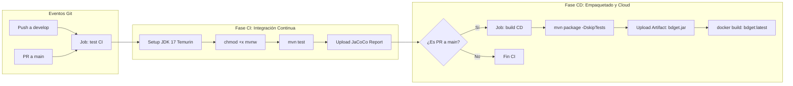

# bdget 🎓 — Microservicio de Gestión de Estudiantes
> **Evaluación Parcial N°1: "Tu primer pipeline de despliegue"**  
> **Asignatura:** Ingeniería DevOps (DOY0101) — Duoc UC  
> **Ponderación:** 25%  

---

## 👥 Información del Equipo

* **Institución:** Duoc UC
* **Carrera:** Ingeniería en Informática / Conectividad y Redes
* **Integrantes:**
  * **Valentina Ruiz** — `va.ruizi@duocuc.cl`
  * **Michelle Gauna** — `ma.gauna@duocuc.cl` (`Miichellee1`)
* **Repositorio GitHub:** [https://github.com/Miichellee1/DevOps-Wisdom-](https://github.com/Miichellee1/DevOps-Wisdom-)

---

## 📖 Descripción del Proyecto

`bdget` es un microservicio REST desarrollado en **Java 17 + Spring Boot 3** para la administración de estudiantes (operaciones CRUD, búsqueda y métricas). Cuenta con persistencia en base de datos H2 en memoria, suite de pruebas unitarias automatizadas con JUnit 5 y Mockito, generación de reportes de cobertura con JaCoCo, y un pipeline de integración y entrega continua (CI/CD) ejecutado en la nube mediante **GitHub Actions**.

---

## 🚀 Cómo Levantar el Proyecto Localmente

### Requisitos Previos
* JDK 17 o superior instalado.
* Git.
* No requiere instalación previa de Maven (se incluye Maven Wrapper `./mvnw`).

### 1. Ejecutar la aplicación
```bash
# En Linux / macOS
./mvnw spring-boot:run

# En Windows (PowerShell / CMD)
.\mvnw.cmd spring-boot:run
```
La API queda disponible en `http://localhost:8080/students`.

### 2. Consola de Base de Datos H2
La base de datos es H2 en memoria (`jdbc:h2:mem:bdgetdb`). No requiere credenciales ni configuración externa y se reinicia en cada arranque. Con la aplicación corriendo, se puede acceder a la consola web en:
* **URL:** `http://localhost:8080/h2-console`
* **JDBC URL:** `jdbc:h2:mem:bdgetdb`
* **Usuario:** `sa`
* **Contraseña:** *(vacía)*

### 3. Ejecutar la suite de pruebas unitarias
```bash
# En Linux / macOS
./mvnw test

# En Windows
.\mvnw.cmd test
```
*Las pruebas se ejecutan de manera aislada en un puerto dinámico (`server.port=0`) y generan automáticamente el reporte de cobertura JaCoCo en `target/site/jacoco/index.html`.*

---

## 📁 Estructura del Proyecto y Arquitectura de Carpetas

El microservicio implementa una **arquitectura en capas desacoplada**, siguiendo las mejores prácticas de desarrollo y el principio de responsabilidad única (SRP):

```
DevOps-Wisdom-/
├── .github/
│   └── workflows/
│       └── main.yml           → Pipeline de CI/CD automatizado en GitHub Actions
├── src/
│   ├── main/
│   │   ├── java/com/example/bdget/
│   │   │   ├── BdgetApplication.java      → Clase principal de arranque Spring Boot
│   │   │   ├── controller/
│   │   │   │   └── StudentController.java  → Capa de entrada REST (endpoints HTTP)
│   │   │   ├── service/
│   │   │   │   ├── StudentService.java     → Interfaz con contratos de lógica de negocio
│   │   │   │   └── StudentServiceImpl.java → Implementación de lógica de negocio
│   │   │   ├── repository/
│   │   │   │   └── StudentRepository.java  → Capa de acceso a datos (Spring Data JPA)
│   │   │   ├── model/
│   │   │   │   └── Student.java            → Entidad JPA persistente
│   │   │   └── exception/
│   │   │       └── GlobalExceptionHandler.java → Manejo centralizado de errores REST
│   │   └── resources/
│   │       └── application.properties     → Configuración de entorno y base de datos
│   └── test/
│       ├── java/com/example/bdget/
│       │   ├── BdgetApplicationTests.java   → Prueba de arranque de contexto
│       │   ├── controller/
│       │   │   └── StudentControllerTest.java → Pruebas de integración web (MockMvc)
│       │   ├── service/
│       │   │   └── StudentServiceImplTest.java→ Pruebas unitarias con mocks (Mockito)
│       │   └── model/
│       │       └── StudentModelTest.java     → Pruebas de entidad y encapsulamiento
│       └── resources/
│           └── application.properties       → Configuración aislada para pruebas (puerto 0)
├── Dockerfile                 → Contenedorización multi-etapa (Temurin 17)
├── pom.xml                    → Declaración de dependencias y plugins Maven (JaCoCo)
├── mvnw / mvnw.cmd            → Maven Wrapper ejecutable multiplataforma
└── README.md                  → Documentación técnica y guía de buenas prácticas
```

---

## 🌳 Estrategia de Ramificación (Indicador IE1)

### 1. Comparativa de Modelos de Ramificación

| Criterio | GitFlow | GitHub Flow | Trunk-Based Development |
| :--- | :--- | :--- | :--- |
| **Estructura de ramas** | Múltiples ramas formales: `main`, `develop`, `feature/*`, `release/*`, `hotfix/*`. | Rama principal (`main`) y ramas efímeras de funcionalidad (`feature/*`). | Una sola rama activa (`trunk` o `main`) con ramas de vida ultracorta (< 24 hrs). |
| **Frecuencia de Despliegue** | Programada por versiones/releases formales (semanal, quincenal, mensual). | Despliegue continuo hacia producción con cada Pull Request mergeado. | Despliegue continuo y ultra frecuente (múltiples veces al día). |
| **Manejo de Hotfixes** | Canal dedicado: rama `hotfix/*` desde `main` que se reintegra a `main` y `develop`. | Se crea una rama corta desde `main` y se mergea de inmediato vía PR. | Corrección directa en el `trunk` y push inmediato hacia producción (o con *feature flags*). |
| **Complejidad de Merge** | Media/Alta: requiere sincronización bidireccional entre ramas de soporte. | Baja: solo se sincroniza con `main`. | Muy baja: resolución constante y temprana de conflictos. |
| **Idoneidad en la Nube** | Excelente para entornos corporativos con auditoría y versionado estricto. | Excelente para servicios web y aplicaciones SaaS ágiles. | Excelente para equipos maduros con cobertura de pruebas > 90% y *feature toggles*. |

### 2. Justificación Técnica de la Elección de GitFlow

Para este proyecto y microservicio se adoptó **GitFlow** debido a las siguientes razones técnicas:
1. **Estabilidad Absoluta en Producción (`main`):** La rama `main` refleja únicamente código probado, empaquetado y en producción, impidiendo que desarrollos incompletos lleguen al entorno operativo.
2. **Espacio de Integración Continua (`develop`):** Permite a la pareja de trabajo consolidar y verificar de forma conjunta los módulos de búsqueda y métricas antes de generar una versión de entrega.
3. **Aislamiento de Funcionalidades (`feature/`):** Cada cambio funcional (`feature/buscar-estudiantes` y `feature/conteo-estudiantes`) se desarrolla y prueba en una rama propia sin interrumpir el avance del otro desarrollador.
4. **Manejo Formal de Incidentes Críticos (`hotfix/`):** Si se detecta una anomalía en producción (como ocurrió con la respuesta ante IDs inexistentes), GitFlow permite intervenir directamente desde `main` sin incorporar código inestable que esté aún en `develop`.

---

## 📝 Convenciones de Commits (Indicador IE5)

Se adoptó el estándar internacional **Conventional Commits v1.0.0**, asegurando que el historial de Git sea legible, estructurado y apto para generación automática de *changelogs*.

### Formato
```
<tipo>[ámbito opcional]: <descripción concisa en minúsculas y modo imperativo>
```

### Tipos Utilizados
* `feat:` Nueva funcionalidad o endpoint incorporado al microservicio.
* `fix:` Corrección de un defecto o bug en el código.
* `test:` Adición o actualización de pruebas unitarias o de integración.
* `docs:` Cambios o adiciones a la documentación técnica.
* `chore:` Tareas rutinarias, configuración de herramientas, dependencias o permisos.
* `merge:` Mensaje formal de integración de ramas.

### Ejemplos Reales Aplicados en el Repositorio
* `feat: implementa busqueda de estudiantes por nombre y pruebas unitarias`
* `feat: implementa endpoint de conteo total de estudiantes y pruebas unitarias`
* `fix: corrige retorno http 404 al consultar estudiante inexistente`
* `chore: corrige permisos de mvnw, optimiza pipeline ci-cd y aisla pruebas`
* `merge: integra feature/buscar-estudiantes en develop`

---

## 🔀 Convenciones de Naming de Ramas (Indicador IE5)

Se establecieron reglas estrictas de nomenclatura en minúsculas, usando guiones como separadores (*kebab-case*):

| Prefijo de Rama | Propósito | Rama Origen | Rama Destino de Merge | Ejemplo Real en el Repo |
| :--- | :--- | :--- | :--- | :--- |
| `main` | Código en producción, estable y etiquetado con versiones. | Inicial | — | `main` |
| `develop` | Rama principal de desarrollo e integración continua. | `main` | `main` | `develop` |
| `feature/<nombre>` | Desarrollo de una nueva funcionalidad aislada. | `develop` | `develop` | `feature/buscar-estudiantes`, `feature/conteo-estudiantes` |
| `hotfix/<nombre>` | Reparación urgente de un fallo detectado en producción. | `main` | `main` y `develop` | `hotfix/corregir-validacion-id` |

---

## 🔀 Flujos de Merge (Indicador IE5)

En GitFlow se utiliza la estrategia de **Merge Commit con preservación de historia (`--no-ff` / No Fast-Forward)**.

* **¿Por qué `--no-ff`?**  
  A diferencia de un *Fast-Forward* (que aplana los commits y borra la evidencia de la rama), `--no-ff` genera un commit de unión explícito. Esto permite:
  * Documentar exactamente cuándo comenzó y terminó el desarrollo de una característica.
  * Mantener la trazabilidad de qué desarrollador integró el cambio y bajo qué Pull Request.
  * Facilitar la reversión (*revert*) de una funcionalidad completa con un solo comando en caso de error.

---

## 🔍 Estrategia de Revisión de Pull Requests (Indicador IE5)

Ningún cambio ingresa a `develop` o `main` sin pasar por un proceso estructurado de revisión de pares:

### Checklist Obligatorio para Aprobación de un PR
1. [x] **Pipeline de CI en Verde:** El workflow de GitHub Actions debe ejecutarse y terminar exitosamente (100% de tests unitarios aprobados).
2. [x] **Revisión de Pares (Peer Review):** El PR debe contar con la aprobación del otro integrante del equipo.
3. [x] **Ausencia de Conflictos:** La rama debe estar actualizada respecto a la rama base (`develop` o `main`).
4. [x] **Cobertura de Código:** Las nuevas funciones deben venir acompañadas de sus correspondientes pruebas unitarias en `src/test`.
5. [x] **Convención de Commits:** Todos los commits deben cumplir con el estándar Conventional Commits.

---

## ⚙️ Automatización (CI/CD) y Entorno Cloud Simulado (Indicadores IE3 e IE4)

El archivo de automatización [.github/workflows/main.yml](file:///c:/Users/valen/Downloads/depossi/proyecto/DevOps-Wisdom-/.github/workflows/main.yml) implementa un pipeline formal compuesto por dos fases:



### 1. Rol de la Automatización en el Proceso CI/CD
* **Integración Continua (CI):** Ejecuta la validación automática del código en cada `push` a `develop`. Previene el *"integration hell"* al detectar regresiones o errores de compilación inmediatamente tras cada aporte colaborativo.
* **Entrega Continua (CD):** Ante un `pull_request` hacia `main`, el pipeline no solo re-valida las pruebas sino que genera el paquete binario ejecutable (`bdget.jar`) y construye la imagen Docker (`docker build`). Esto garantiza que el software esté siempre en un estado desplegable en cualquier proveedor de nube (AWS, GCP, Azure o Kubernetes).
* **Entorno Cloud Simulado:** Las máquinas virtuales `ubuntu-latest` provistas por GitHub Actions actúan como un entorno cloud simulado donde se ejecutan los contenedores y herramientas en un entorno idéntico a producción, independiente de los sistemas operativos locales de los desarrolladores.

---

## 📊 Trazabilidad del Flujo Colaborativo (Indicador IE2)

A continuación se detalla la secuencia de simulación colaborativa desarrollada en el proyecto:

| Etapa | Rama Involucrada | Comandos Git Clave | Descripción del Cambio | Resultado |
| :--- | :--- | :--- | :--- | :--- |
| **0. Baseline Fixes** | `main` | `git update-index --chmod=+x mvnw`, `git commit` | Corrección de permisos de ejecución en Linux, aislamiento de puerto `0` en tests y ajuste del pipeline CI/CD. | Build y pruebas en verde (13 tests OK). |
| **1. Inicialización GitFlow** | `develop` | `git checkout -b develop` | Creación de la rama base de desarrollo e integración a partir de `main`. | Rama `develop` activa. |
| **2. Feature 1** | `feature/buscar-estudiantes` | `git checkout -b feature/...`, `git commit` | Endpoint `GET /students/search?name={nombre}` con pruebas unitarias en servicio y controlador. | 15 tests OK. |
| **3. Merge Feature 1** | `develop` | `git checkout develop`, `git merge --no-ff feature/...` | Integración de Feature 1 en la rama de desarrollo manteniendo la historia. | Grafo histórico preservado. |
| **4. Feature 2** | `feature/conteo-estudiantes` | `git checkout -b feature/...`, `git commit` | Endpoint `GET /students/count` para métricas del total de estudiantes con tests. | 17 tests OK. |
| **5. Merge Feature 2** | `develop` | `git checkout develop`, `git merge --no-ff feature/...` | Integración de Feature 2 en `develop`. | Grafo histórico preservado. |
| **6. Release 0.1.0** | `main` | `git checkout main`, `git merge --no-ff develop` | Fusión de `develop` hacia `main` simulando la entrega a producción. | Versión productiva 0.1.0 lista. |
| **7. Hotfix Producción** | `hotfix/corregir-validacion-id` | `git checkout -b hotfix/...`, `git commit` | Corrección de bug crítico: retorno HTTP 404 al consultar estudiantes inexistentes con su respectivo test. | 18 tests OK (100% éxito). |
| **8. Sincronización Hotfix** | `main` y `develop` | `git merge --no-ff hotfix/...` | Fusión del hotfix en `main` y sincronización inmediata hacia `develop` para evitar regresiones. | Ciclo completo cerrado. |

---

## 🐳 Contenedorización con Docker

El proyecto incluye un [Dockerfile](Dockerfile) multi-etapa optimizado con **Eclipse Temurin 17**:

```dockerfile
# Etapa 1: Compilación
FROM eclipse-temurin:17-jdk AS buildstage
RUN apt-get update && apt-get install -y maven
WORKDIR /app
COPY pom.xml .
COPY src /app/src
RUN mvn clean package -DskipTests

# Etapa 2: Imagen liviana de producción
FROM eclipse-temurin:17-jre
WORKDIR /app
COPY --from=buildstage /app/target/bdget-0.0.1-SNAPSHOT.jar /app/bdget.jar
EXPOSE 8080
ENTRYPOINT [ "java", "-jar", "/app/bdget.jar" ]
```

Para construir y levantar el contenedor manualmente:
```bash
docker build -t bdget:latest .
docker run -p 8080:8080 bdget:latest
```

---

## ⚖️ Declaración de Uso Ético de Inteligencia Artificial (Normativa Duoc UC)

En cumplimiento de las instrucciones y la normativa institucional sobre el uso ético de Inteligencia Artificial:

1. **Herramientas Utilizadas:** Se utilizó un asistente de Inteligencia Artificial generativa como herramienta de consulta y apoyo técnico.
2. **Aplicación Específica:**
   * Apoyo en la redacción, formateo y diseño de tablas técnicas comparativas en el `README.md`.
   * Verificación de la sintaxis del archivo YAML para el pipeline de GitHub Actions ([main.yml](.github/workflows/main.yml)).
   * Asistencia en el diagnóstico del error de colisión de puertos en las pruebas unitarias locales.
3. **Declaración de Autoría y Responsabilidad:**
   * Todas las decisiones arquitectónicas, la selección del modelo de ramificación GitFlow, la implementación del código Java, el diseño de endpoints y la validación de pruebas unitarias fueron supervisadas, probadas y ejecutadas por el equipo de estudiantes.
   * El equipo asume total responsabilidad de la validez y originalidad del contenido entregado.
4. **Referencia Institucional:** Lineamientos de uso ético de IA Duoc UC disponibles en [https://bibliotecas.duoc.cl/ia](https://bibliotecas.duoc.cl/ia).

---

## 💡 Reflexiones Individuales Obligatorias (Normativa Duoc UC)

*(Cada integrante incluye a continuación su reflexión personal, redactada de forma individual y sin apoyo de IA, explicando su aprendizaje y contribución al proyecto según lo estipulado en la pauta de evaluación).*

### 👤 Reflexión de Valentina Ruiz
> *(Espacio para que Valentina redacte su reflexión personal sobre los aprendizajes obtenidos en Git, ramas, flujos colaborativos y su contribución en la configuración del pipeline).*

### 👤 Reflexión de Michelle Gauna
> *(Espacio para que Michelle redacte su reflexión personal sobre el trabajo en equipo, la gestión de ramas con GitFlow y la automatización CI/CD con GitHub Actions).*
