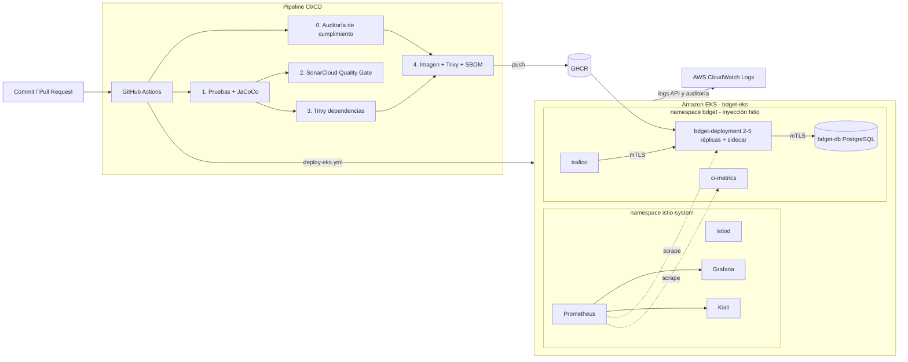
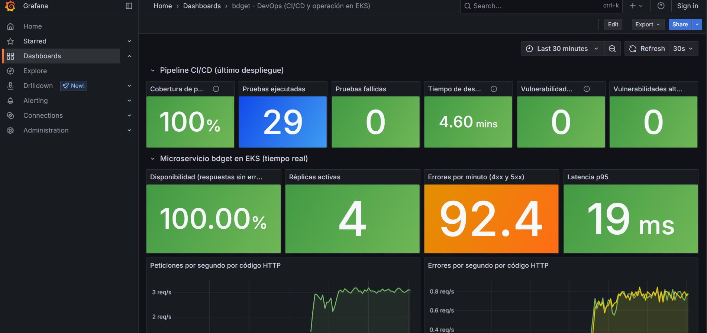
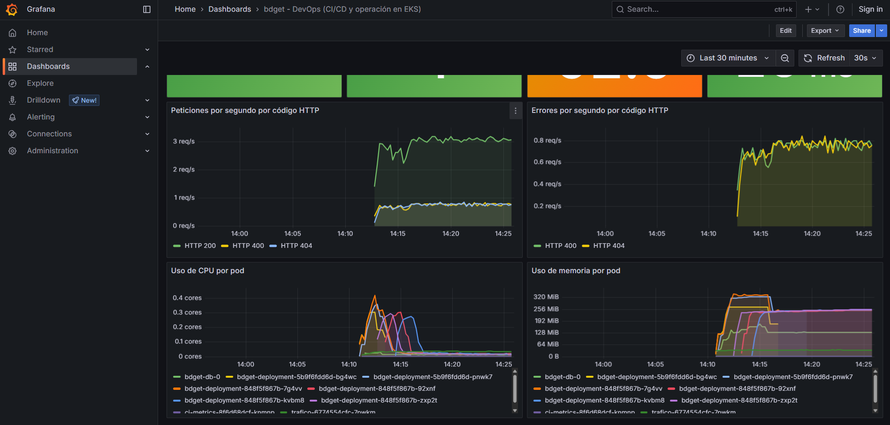

# Informe — Evaluación Parcial N°3

## Observabilidad y entornos reales en DevOps

| | |
|---|---|
| **Asignatura** | Ingeniería DevOps (DOY0101) — Duoc UC |
| **Integrantes** | Valentina Ruiz (`va.ruizi@duocuc.cl`) · Michelle Serrano (`mich.serrano@duocuc.cl`) |
| **Repositorio** | [github.com/Miichellee1/DevOps-Wisdom-](https://github.com/Miichellee1/DevOps-Wisdom-) |
| **Microservicio** | `bdget`: API REST de estudiantes (Java 17 + Spring Boot 3.5 + PostgreSQL) |
| **Nube** | Amazon EKS (Kubernetes 1.37), región `us-east-1`, AWS Academy Learner Lab |

---

## 1. Resumen

Extendimos el pipeline CI/CD DevSecOps de la Evaluación 2 para operar el microservicio **en un entorno real de nube**. El microservicio se despliega en **Amazon EKS** dentro de una malla de servicios **Istio**, que mide todo el tráfico sin modificar el código. **Prometheus** guarda las métricas, **Grafana** las muestra en un dashboard propio que une métricas del pipeline (cobertura, pruebas, vulnerabilidades, tiempo de despliegue) con métricas de operación (disponibilidad, errores, latencia, CPU y memoria), y **Kiali** dibuja el tráfico entre servicios. Los logs del plano de control y la **auditoría de Kubernetes** quedan en **AWS CloudWatch**.

El cumplimiento se aplica de forma automatizada en cada cambio: auditoría con 12 políticas basadas en normas (CIS, Pod Security Standards, OpenSSF, OWASP, ISO), Quality Gate de SonarCloud, escaneo de vulnerabilidades con Trivy y reglas de protección de ramas. **Si cualquier control falla, el pipeline se detiene y no se despliega**; lo demostramos con una falla real y con fallas simuladas.

| Indicador | Qué se implementó | Evidencia |
|---|---|---|
| IE1 Monitoreo y logs | Prometheus, Grafana, Kiali, CloudWatch Logs | Secciones 4 y evidencias 02–07 |
| IE2 Despliegue en la nube | EKS + Istio, despliegue automatizado desde GitHub Actions | Sección 3 y evidencias `proceso-*`, 01 |
| IE3 Dashboard | Dashboard `bdget - DevOps` con métricas CI/CD y de operación | Sección 5 y evidencias 05a–05b |
| IE4 Integración y decisiones | Documentación del flujo y decisiones tomadas con los datos | Sección 7 |
| IE5 Cumplimiento | Auditoría automatizada, SonarCloud, branch protection, Trivy, auditoría de K8s | Sección 6 y evidencias 08a–08b |
| IE6 Detención ante fallas | Compuertas que bloquean el despliegue; falla real y simuladas | Sección 8 y evidencia 09 |

---

## 2. Arquitectura



| Componente | Rol |
|---|---|
| **Amazon EKS** | Kubernetes administrado: AWS opera el plano de control; nosotras, 2 nodos EC2 `t3.large` (grupo de nodos con `LabRole`) |
| **Istio** (perfil demo) | Inyecta un sidecar Envoy en cada pod del namespace `bdget`: mide peticiones, errores y latencias, y cifra el tráfico con mTLS |
| **Prometheus** | Recolecta métricas de Istio, de los contenedores (cAdvisor) y del exportador de métricas CI/CD |
| **Grafana** | Dashboard propio `bdget - DevOps` + dashboards de Istio |
| **Kiali** | Grafo de tráfico, salud, métricas y logs por workload |
| **metrics-server** | Métricas de CPU y memoria para el HPA |
| **CloudWatch Logs** | Logs del API server, del autenticador y de **auditoría** de Kubernetes |
| **trafico** | Generador de tráfico dentro de la malla, con errores 404 y 400 intencionales |
| **ci-metrics** | Expone en formato Prometheus las métricas del último despliegue (cobertura, pruebas, vulnerabilidades, tiempos, commit) |

---

## 3. Despliegue en la nube (IE2)

### 3.1 Infraestructura creada en AWS

| Paso | Comando principal | Evidencia |
|---|---|---|
| Clúster EKS con logs de control en CloudWatch | `aws eks create-cluster ... --logging api,audit,authenticator` | [proceso-1](evidencias/proceso-1-creacion-cluster-eks.png) |
| Grupo de nodos (2 × `t3.large`, escalable a 3) | `aws eks create-nodegroup ... --node-role LabRole` | [proceso-2](evidencias/proceso-2-grupo-de-nodos.png) |
| Conexión de kubectl | `aws eks update-kubeconfig --name bdget-eks` | [proceso-3](evidencias/proceso-3-kubectl-nodos.png) |
| Istio | `istioctl install --set profile=demo ...` (recursos mínimos, como el material de clase) | [proceso-4](evidencias/proceso-4-instalacion-istio.png) |
| Prometheus, Grafana y Kiali | `kubectl apply -f samples/addons/*` (misma versión de Istio) | [proceso-5](evidencias/proceso-5-prometheus-grafana-kiali.png) |
| metrics-server | `aws eks create-addon --addon-name metrics-server` | [01a](evidencias/01a-cluster-pods-hpa.png) |
| Microservicio bdget | `bash scripts/eks/desplegar.sh` | [proceso-6](evidencias/proceso-6-despliegue-bdget-eks.png) |

### 3.2 Configuraciones de monitoreo y trazabilidad aplicadas automáticamente

El script [`scripts/eks/desplegar.sh`](../scripts/eks/desplegar.sh) reutiliza **los mismos manifiestos de Kubernetes de la Evaluación 2** y agrega lo necesario para la observabilidad:

1. Namespace `bdget` con `istio-injection=enabled` ([`k8s/eks/00-namespace-istio.yaml`](../k8s/eks/00-namespace-istio.yaml)): cada pod recibe su sidecar y queda medido.
2. Secret de la base de datos con clave aleatoria (`openssl rand`), nunca versionada.
3. Imagen del commit (`ghcr.io/miichellee1/devops-wisdom:<tag>`) y anotación `change-cause` para el historial de despliegues.
4. `holdApplicationUntilProxyStarts`: la app espera a su sidecar para no fallar al conectarse a la base de datos.
5. Generador de tráfico ([`k8s/eks/trafico.yaml`](../k8s/eks/trafico.yaml)) y exportador de métricas CI/CD ([`k8s/eks/ci-metrics.yaml`](../k8s/eks/ci-metrics.yaml)) con anotaciones `prometheus.io/*` para que Prometheus lo descubra solo.
6. Medición del tiempo de despliegue y publicación de las métricas CI/CD ([`scripts/eks/publicar-metricas-ci.sh`](../scripts/eks/publicar-metricas-ci.sh)).
7. Importación del dashboard versionado ([`scripts/eks/importar-dashboard.sh`](../scripts/eks/importar-dashboard.sh)).

### 3.3 Despliegue continuo desde el pipeline

El workflow [`.github/workflows/deploy-eks.yml`](../.github/workflows/deploy-eks.yml) automatiza todo el despliegue:

| Job | Qué hace |
|---|---|
| **1. Compuertas** | Auditoría de cumplimiento → pruebas y cobertura mínima → escaneo Trivy de la imagen a desplegar (reporte + bloqueo) |
| **2. Despliegue en EKS** | Solo si el job 1 aprobó: credenciales desde *GitHub Secrets*, `update-kubeconfig`, `desplegar.sh`, smoke test contra EKS, métricas CI/CD (cobertura, pruebas, vulnerabilidades, duración del despliegue y del pipeline), dashboard actualizado y reporte de trazabilidad |

Las credenciales del laboratorio son temporales, por eso se guardan como secretos (`AWS_ACCESS_KEY_ID`, `AWS_SECRET_ACCESS_KEY`, `AWS_SESSION_TOKEN`) y se renuevan en cada sesión del Learner Lab.

### 3.4 Resultado

- 2 nodos `Ready`, Istio y sus complementos `Running` ([01a](evidencias/01a-cluster-pods-hpa.png)).
- Pods de la app con **2/2 contenedores** (app + sidecar).
- El **HPA escaló de 2 a 4 réplicas** por el consumo de CPU durante el arranque de Spring Boot, y luego se estabilizó con CPU 8 % de 70 % y memoria 64 % de 80 % ([01b](evidencias/01b-hpa-y-consumo-recursos.png)).
- Despliegue completo en **276 segundos**.

---

## 4. Monitoreo y logging (IE1)

| Necesidad | Herramienta | Fuente del dato | Evidencia |
|---|---|---|---|
| **Logs de la aplicación** | Kiali → Workloads → Registros; `kubectl logs` | Logs del contenedor y del sidecar Envoy (método, ruta, código HTTP, tiempo) | [03](evidencias/03-kiali-logs.png) |
| **Logs de la plataforma y auditoría** | AWS CloudWatch Logs Insights | `/aws/eks/bdget-eks/cluster`: `kube-apiserver`, `kube-apiserver-audit`, `authenticator` | [07](evidencias/07-cloudwatch-log-streams.png) |
| **Métricas de uso** | Prometheus + Grafana; `kubectl top`; HPA | cAdvisor (`container_cpu_usage_seconds_total`, `container_memory_working_set_bytes`) y metrics-server | [05b](evidencias/05b-grafana-dashboard-bdget-recursos.png), [01b](evidencias/01b-hpa-y-consumo-recursos.png) |
| **Errores** | Kiali, Grafana | `istio_requests_total` por `response_code` (4xx y 5xx) | [02](evidencias/02-kiali-grafo-trafico.png), [05a](evidencias/05a-grafana-dashboard-bdget.png) |
| **Disponibilidad** | Grafana, Kiali, sondas de Kubernetes | Tasa de respuestas sin 5xx, réplicas listas, readiness/liveness | [05a](evidencias/05a-grafana-dashboard-bdget.png), [06](evidencias/06-grafana-istio-service.png) |
| **Latencia y volumen** | Kiali, Grafana (dashboard de Istio) | `istio_request_duration_milliseconds` | [04](evidencias/04-kiali-metricas-entrantes.png), [06](evidencias/06-grafana-istio-service.png) |
| **Seguridad del tráfico** | Kiali (candados) | mTLS automático de Istio entre servicios | [02](evidencias/02-kiali-grafo-trafico.png) |

**Lectura de los datos observados:** el grafo de Kiali muestra `trafico → bdget → bdget-db` con **33 % de error** en la primera conexión. Corresponde exactamente a los errores intencionales del generador (2 de cada 6 llamadas: un 404 y un 400), lo que confirma que el monitoreo detecta y clasifica bien los errores. La conexión a la base de datos tiene 100 % de éxito y el servicio no registra respuestas 5xx (disponibilidad 100 %).

---

## 5. Dashboard de métricas clave (IE3)

El dashboard **`bdget - DevOps (CI/CD y operación en EKS)`** está versionado en [`observability/grafana-dashboard-bdget.json`](../observability/grafana-dashboard-bdget.json) y el pipeline lo importa en cada despliegue.




| Panel | Métrica (PromQL) | Origen | Valor observado |
|---|---|---|---|
| Cobertura de pruebas | `ci_test_coverage_percent` | JaCoCo en el pipeline | 100 % |
| Pruebas ejecutadas / fallidas | `ci_tests_total`, `ci_tests_failed` | Surefire en el pipeline | 29 / 0 |
| Tiempo de despliegue | `ci_deploy_duration_seconds` | Medido por `desplegar.sh` | 4,6 min |
| Vulnerabilidades críticas / altas | `ci_vulnerabilities{severity=...}` | Trivy sobre la imagen desplegada | 0 / 0 |
| Disponibilidad | `% de istio_requests_total sin 5xx` | Sidecars de Istio | 100 % |
| Réplicas activas | `count(container_memory_working_set_bytes{container="bdget-container"})` | cAdvisor | 4 |
| Errores por minuto | `60 * rate(istio_requests_total{response_code=~"4..|5.."})` | Istio | 92,4 |
| Latencia p95 | `histogram_quantile(0.95, istio_request_duration_milliseconds_bucket)` | Istio | 19 ms |
| Peticiones y errores por código HTTP | `rate(istio_requests_total) by (response_code)` | Istio | 200, 400 y 404 |
| CPU y memoria por pod | cAdvisor por `pod` | Kubelet | Picos al iniciar cada réplica |

**Cómo se integra con el CI/CD:** el pipeline calcula la cobertura, las pruebas, las vulnerabilidades y los tiempos, y los publica en el ConfigMap `ci-metrics`. Un pod liviano los expone en formato Prometheus, y así el mismo dashboard muestra la **calidad con que se construyó** la versión junto al **comportamiento que tiene en producción**. Cada panel tiene umbrales de color (verde/naranjo/rojo) para leerlo de un vistazo.

---

## 6. Políticas de cumplimiento y auditoría automatizada (IE5)

| Capa | Herramienta | Qué exige | Cuándo se aplica |
|---|---|---|---|
| Auditoría de políticas | [`scripts/auditoria/auditoria-cumplimiento.sh`](../scripts/auditoria/auditoria-cumplimiento.sh) | 12 políticas (tabla siguiente) | Job 0 del pipeline principal y job 1 de `deploy-eks` |
| Calidad y seguridad del código | SonarCloud Quality Gate | Calificación A en seguridad, confiabilidad y mantenibilidad; cobertura ≥ 80 % y duplicación ≤ 3 % en código nuevo | Cada push y PR |
| Vulnerabilidades | Trivy + `.trivyignore` con vencimiento | Sin CRITICAL/HIGH con parche en dependencias ni en la imagen | Cada push, PR y despliegue |
| Dependencias | Dependabot | Actualizaciones semanales por PR hacia `develop` | Semanal |
| Control de cambios | Branch protection en `main` y `develop` | Merge solo por PR y con los checks obligatorios en verde | Cada PR |
| Auditoría de la plataforma | Logs de auditoría de EKS en CloudWatch | Registro de quién hizo qué cambio en el clúster | Permanente |
| Seguridad del tráfico | Istio mTLS | Comunicación cifrada y autenticada entre servicios | Permanente |

**Políticas de la auditoría automatizada** (todas cumplen; si una falla, el pipeline se detiene):

| ID | Política | Norma / referencia |
|---|---|---|
| POL-01 | La imagen se ejecuta con un usuario sin privilegios | CIS Docker Benchmark 4.1 |
| POL-02 | La imagen define un HEALTHCHECK | CIS Docker Benchmark 4.6 |
| POL-03 | Imágenes base con versión fija | CIS Docker Benchmark 4.2 |
| POL-04 | Contenedores con límites de CPU y memoria | Kubernetes / gobernanza de recursos |
| POL-05 | Workloads con `runAsNonRoot` | Kubernetes Pod Security Standards |
| POL-06 | Contenedores sin escalamiento de privilegios | Kubernetes Pod Security Standards |
| POL-07 | Manifiestos sin imágenes `:latest` | Buenas prácticas de Kubernetes |
| POL-08 | Acciones de GitHub fijadas por SHA | OpenSSF Scorecard / SLSA |
| POL-09 | Workflows con permisos mínimos | OpenSSF Scorecard (Token-Permissions) |
| POL-10 | Sin secretos en el repositorio | OWASP Top 10 A02 / ASVS V6 |
| POL-11 | Excepciones de seguridad con vencimiento | ISO/IEC 27001 A.8.8 (gestión de vulnerabilidades) |
| POL-12 | Cobertura mínima de pruebas ≥ 80 % | Política de calidad (ISO/IEC 25010) |

**Auditoría de Kubernetes en CloudWatch:** la consulta de Logs Insights sobre `kube-apiserver-audit` muestra cada cambio en el namespace `bdget` con fecha, usuario, acción y recurso: la creación del Secret, ConfigMaps, Deployments, StatefulSet, HPA, PDB y cuota hecha por el despliegue ([08b](evidencias/08b-cloudwatch-auditoria-cambios-usuario.png)), y también las decisiones automáticas del HPA ([08a](evidencias/08a-cloudwatch-auditoria-hpa.png)).

```sql
fields @timestamp, user.username, verb, objectRef.resource, objectRef.name
| filter @logStream like /audit/ and objectRef.namespace = "bdget"
  and verb in ["create", "patch", "update", "delete"] and user.username not like /system:/
| sort @timestamp desc
```

---

## 7. Integración en el pipeline y toma de decisiones (IE4)

| Etapa | Herramienta | Pregunta que responde | Decisión que habilita |
|---|---|---|---|
| Antes de construir | Auditoría de cumplimiento | ¿El cambio respeta las políticas de seguridad y gobernanza? | Bloquear si no |
| Pruebas | JUnit + JaCoCo | ¿Funciona y está probado (≥ 80 %)? | Bloquear si no |
| Análisis estático | SonarCloud | ¿El código nuevo es seguro y mantenible? | Bloquear si no; priorizar correcciones |
| Seguridad | Trivy | ¿Las librerías o la imagen tienen vulnerabilidades conocidas con parche? | Bloquear, actualizar o documentar una excepción con vencimiento |
| Despliegue | deploy-eks + métricas CI/CD | ¿Cuánto tarda y qué versión quedó desplegada? | Detectar despliegues lentos; trazabilidad commit → imagen → pod |
| Operación | Prometheus, Grafana, Kiali | ¿Está disponible? ¿Cuántos errores? ¿Cuánta latencia y recursos? | Investigar errores, ajustar recursos o réplicas, revertir una versión |
| Auditoría | CloudWatch | ¿Quién cambió qué y cuándo? | Responder incidentes y demostrar cumplimiento |

**Decisiones que tomamos en este proyecto a partir de los datos:**

1. **SonarCloud detectó inyección de comandos** (regla S7630, severidad *BLOCKER*) en el workflow nuevo: corregimos pasando los datos por variables de entorno y validando su formato antes de desplegar ([09](evidencias/09-ie6-sonarcloud-bloquea-inyeccion.png)).
2. **El driver EBS CSI falló** (`CrashLoopBackOff`) porque el `LabRole` no permite crear discos: decidimos usar un volumen efímero para PostgreSQL en EKS y documentarlo como limitación.
3. **El HPA escaló a 4 réplicas** al ver el pico de CPU del arranque. El dashboard y `kubectl top` mostraron que luego el consumo baja a entre 13 y 34 milicores de CPU por réplica; esto indica que los *requests* de CPU podrían bajarse y el escalado ajustarse para no sobredimensionar.
4. **El panel de errores (92 por minuto) quedó en naranjo:** al cruzarlo con el gráfico por código HTTP vimos que son solo 400 y 404 (errores del cliente) y 0 % de 5xx; la disponibilidad real del servicio es 100 %.
5. **Trivy dejó de instalarse en el pipeline** ("unable to find v0.76.1"): el log mostró que el instalador de la acción consulta la API de GitHub sin autenticación y los runners compartidos superan el límite de consultas. Lo distinguimos de una vulnerabilidad real porque el reporte ni siquiera se generó. Decidimos instalar Trivy descargando la release oficial directamente y **verificando su checksum SHA-256**, lo que además fortalece la cadena de suministro del pipeline.

---

## 8. Detención del pipeline ante fallas críticas (IE6)

| Falla | Mecanismo | Efecto | Evidencia |
|---|---|---|---|
| Vulnerabilidad de seguridad en el código (real) | SonarCloud Quality Gate | Job 2 en rojo; despliegues 5 y 6 omitidos; PR bloqueado | [09](evidencias/09-ie6-sonarcloud-bloquea-inyeccion.png) |
| Imagen con vulnerabilidades CRITICAL (simulada) | Trivy en `deploy-eks.yml` (`simular_falla_seguridad`) | El despliegue en EKS no se ejecuta | [10](evidencias/10-ie6-falla-seguridad-bloquea-despliegue.png) |
| Cobertura bajo el mínimo (simulada) | `jacoco:check` en `deploy-eks.yml` (`simular_falla_calidad`) | El despliegue en EKS no se ejecuta | [11](evidencias/11-ie6-falla-calidad-bloquea-despliegue.png) |
| Política de cumplimiento incumplida | Auditoría (job 0) | La imagen no se construye ni se despliega | Ejecución del pipeline |
| Merge sin checks en verde | Branch protection | GitHub no permite el merge | Configuración del repositorio |

---

## 9. Limitaciones y mejoras

- **Persistencia en EKS:** en el Learner Lab el `LabRole` no permite al driver EBS CSI crear discos, por lo que PostgreSQL usa un volumen efímero en EKS. Con una cuenta estándar se activa el disco gp3 con `PERSISTENCIA=ebs` (ya incluido en el script).
- **Credenciales temporales:** las del laboratorio caducan con cada sesión; en una cuenta real se usaría OIDC de GitHub con un rol de IAM, sin claves guardadas.
- **Exposición de Kiali y Grafana:** se publicaron con LoadBalancer para el laboratorio; en producción irían detrás de autenticación o por `port-forward`.
- **Alertas:** los umbrales del dashboard son visuales; el siguiente paso es configurar alertas de Grafana o Alertmanager (por ejemplo, disponibilidad < 99 %).

---

## 10. Cómo reproducirlo

```bash
# En AWS CloudShell, con el clúster EKS creado e Istio instalado
git clone https://github.com/Miichellee1/DevOps-Wisdom-.git && cd DevOps-Wisdom-
IMAGE=ghcr.io/miichellee1/devops-wisdom:latest bash scripts/eks/desplegar.sh
bash scripts/eks/importar-dashboard.sh
kubectl patch svc kiali grafana -n istio-system -p '{"spec":{"type":"LoadBalancer"}}'
```

Desde GitHub: **Actions → Despliegue continuo en Amazon EKS con observabilidad → Run workflow**.

---

## 11. Declaración de uso de Inteligencia Artificial

- **Herramienta:** Claude (Anthropic), a través de Claude Code.
- **Uso:** guía paso a paso para crear el clúster EKS e instalar Istio, Prometheus, Grafana y Kiali; apoyo en la sintaxis de los manifiestos, scripts, workflow y dashboard; diagnóstico de errores (driver EBS, Trivy, SonarCloud) y apoyo en la redacción de esta documentación.
- **Validación:** el equipo ejecutó cada paso en AWS, revisó los resultados y tomó las capturas de evidencia.
- **Autoría:** las conclusiones y reflexiones individuales fueron redactadas por cada integrante sin apoyo de IA.
- **Referencia:** [bibliotecas.duoc.cl/ia](https://bibliotecas.duoc.cl/ia)

---

## 12. Conclusiones y reflexiones individuales

*(Sección redactada por el equipo, sin apoyo de IA, como exige la pauta).*

### Conclusiones del equipo
> *(Pendiente: conclusiones del equipo).*

### Reflexión de Valentina Ruiz
> *(Pendiente: aprendizaje y contribución al proyecto).*

### Reflexión de Michelle Serrano
> *(Pendiente: aprendizaje y contribución al proyecto).*
